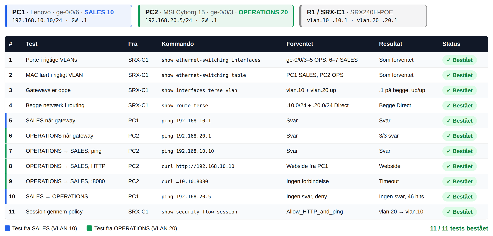

# Testplan – Assignment 37 (SRX Routing Traffic Between VLANs)

Udført 2026-11-10 på R1 / SRX-C1 (SRX240H-POE) med to PC'er. Enheder og adresser som i [README](README.md) og [HLD](HLD.pdf).

| Enhed | Maskine | Port | VLAN / zone | MAC | Adresse |
|---|---|---|---|---|---|
| PC1 | Lenovo (skolens) | ge-0/0/6 | SALES (10) | 68:f7:28:be:46:85 | 192.168.10.10/24, statisk, GW 192.168.10.1 |
| PC2 | MSI Cyborg 15 (Sebastian) | ge-0/0/3 | OPERATIONS (20) | 34:5a:60:29:94:d8 | 192.168.20.5/24, statisk, GW 192.168.20.1 |
| R1 / SRX-C1 | SRX240H-POE, AH4113AK0093 | vlan.10 / vlan.20 | SALES / OPERATIONS | 28:8a:1c:47:ad:50 | 192.168.10.1/24 og 192.168.20.1/24 |

Forberedelse: Wi-Fi er slået fra på begge PC'er, så trafikken går gennem SRX-C1. PC1 kører to webservere til test 8 og 9 (`python -m http.server 80` og `python -m http.server 8080`).



## Tests

| # | Test | Fra | Kommando | Forventet | Resultat | Status |
|---|---|---|---|---|---|---|
| 1 | Porte i rigtige VLANs | SRX-C1 | `show ethernet-switching interfaces` | ge-0/0/3–5 i OPERATIONS, ge-0/0/6–7 i SALES, untagged | Som forventet; ge-0/0/3 og 0/6 up | Bestået |
| 2 | MAC-adresser lært i rigtigt VLAN | SRX-C1 | `show ethernet-switching table` | PC1 i SALES, PC2 i OPERATIONS | PC1 på ge-0/0/6 i SALES, PC2 på ge-0/0/3 i OPERATIONS | Bestået |
| 3 | Gateways er oppe | SRX-C1 | `show interfaces terse vlan` | vlan.10 og vlan.20 up/up med .1 | 192.168.10.1/24 og 192.168.20.1/24 up/up | Bestået |
| 4 | Begge netværk i routingtabellen | SRX-C1 | `show route terse` | 192.168.10.0/24 og 192.168.20.0/24 som Direct | Begge Direct, .1/32 som Local | Bestået |
| 5 | SALES når sin gateway | PC1 | `ping 192.168.10.1` | Svar | Svar | Bestået |
| 6 | OPERATIONS når sin gateway | PC2 | `ping 192.168.20.1` | Svar | 3/3 svar, 1 ms | Bestået |
| 7 | OPERATIONS → SALES, ping | PC2 | `ping 192.168.10.10` | Svar | Svar (efter Wi-Fi blev slået fra på PC2) | Bestået |
| 8 | OPERATIONS → SALES, HTTP | PC2 | `curl.exe http://192.168.10.10` | Webside fra PC1 | Webside fra PC1 (se `pc2-output.txt`); `Allow_HTTP_and_ping` +1 hit | Bestået |
| 9 | OPERATIONS → SALES, anden port | PC2 | `curl.exe --max-time 5 http://192.168.10.10:8080` | Ingen forbindelse, policy tillader kun port 80 | Timeout efter 5 s (se `pc2-output.txt`); SRX ser 3 SYN-forsøg, ingen session | Bestået |
| 10 | SALES → OPERATIONS afvist | PC1 | `ping 192.168.20.5` | Ingen svar, deny-policy rammes | Ingen svar; `deny_all_traffic` har 46 hits | Bestået |
| 11 | Trafikken går gennem policy | SRX-C1 | `show security flow session` under `ping -t` fra PC2 | Session 192.168.20.5 → 192.168.10.10, policy Allow_HTTP_and_ping | Sessioner In vlan.20 → Out vlan.10, policy Allow_HTTP_and_ping | Bestået |

## Konklusion

11/11 tests bestået. SRX-C1 router mellem SALES og OPERATIONS via de virtuelle interfaces vlan.10 og vlan.20. PC2 på OPERATIONS kan pinge og hente en webside fra PC1 på SALES, men port 8080 bliver afvist, fordi policyen kun tillader HTTP og ping. PC1 på SALES kan ikke nå OPERATIONS, og hit-count viser at det er `deny_all_traffic`, der stopper trafikken.

**Bemærkning til test 9:** Der er ingen "denied by policy"-linje for port 8080, fordi den del af trace-loggen var roteret væk. Beviset er de 3 SYN-forsøg fra samme kildeport (57500) uden svar i `srx-output-test8-10.txt`, timeout i `pc2-output.txt`, og at `Allow_HTTP_and_ping` ikke steg for 8080. Port 8080 rammer default deny-all, som ikke har en tæller i hit-count.

**Bemærkning til test 10:** I `srx-output-test8-10.txt` steg `deny_all_traffic` fra 46 til 208 hits under curl-testene, selvom curl kom fra PC2 og ikke kan ramme den policy. Den sandsynlige forklaring er, at ping fra PC1 i test 10 stadig kørte (Linux-ping stopper ikke af sig selv). Det passer med de 162 ekstra hits og deny-linjerne med et sekunds mellemrum kl. 09:55, men det er ikke bekræftet. Trace-filteret (f1, source-prefix 192.168.20.5/32) har desuden fanget trafikken fra SALES mod 192.168.20.5, selvom det kun var sat på kilden. Hvorfor er ikke undersøgt.

**Bemærkning til test 7:** Ping virkede først, da Wi-Fi blev slået fra på PC2. Med Wi-Fi tændt havde PC2 to default gateways, og Windows sendte trafikken til 192.168.10.10 ud på skolens Wi-Fi i stedet for til SRX-C1.

## Output fra SRX-C1

### `show security policies hit-count` (test 10)

```
 Index   From zone        To zone           Name                Policy count
 1       SALES            OPERATIONS        deny_all_traffic    46
 2       OPERATIONS       SALES             Allow_HTTP_and_ping 86
```

Tælleren viser hvor mange gange hver policy er brugt. `deny_all_traffic` har 46 hits fra PC1's ping mod OPERATIONS. Det viser at ping'en faktisk nåede SRX-C1 og blev afvist af policyen, og ikke bare forsvandt et andet sted.

### `show security flow session` (test 11)

```
Session ID: 31532, Policy name: Allow_HTTP_and_ping/7, Timeout: 2, Valid
  In: 192.168.20.5/41 --> 192.168.10.10/1;icmp, If: vlan.20, Pkts: 1, Bytes: 60
  Out: 192.168.10.10/1 --> 192.168.20.5/41;icmp, If: vlan.10, Pkts: 1, Bytes: 60
```

Hver ping fra PC2 bliver til en session i SRX-C1. `In` er pakken fra PC2, som kommer ind på vlan.20. `Out` er svaret fra PC1, som kommer tilbage på vlan.10. Policy-navnet viser at det er `Allow_HTTP_and_ping`, der tillader trafikken fra OPERATIONS til SALES. Sessionen lukker efter få sekunder (timeout 2–4), derfor skal ping køre uafbrudt for at se den.

### `show route terse`

```
A Destination        P Prf   Metric 1   Metric 2  Next hop         AS path
* 192.168.10.0/24    D   0                       >vlan.10
* 192.168.10.1/32    L   0                        Local
* 192.168.20.0/24    D   0                       >vlan.20
* 192.168.20.1/32    L   0                        Local
```

`D` (Direct) er de to VLAN-netværk, som SRX-C1 selv sidder på via vlan.10 og vlan.20. `L` (Local) er SRX'ens egne adresser. Der er ingen statiske ruter eller default route, fordi SRX-C1 kun skal route mellem de to VLANs.

### `show ethernet-switching interfaces`

```
Interface    State  VLAN members        Tag   Tagging  Blocking
ge-0/0/3.0   up     OPERATIONS          20    untagged unblocked
ge-0/0/4.0   down   OPERATIONS          20    untagged unblocked
ge-0/0/5.0   down   OPERATIONS          20    untagged unblocked
ge-0/0/6.0   up     SALES               10    untagged unblocked
ge-0/0/7.0   down   SALES               10    untagged unblocked
```

Viser hvilket VLAN hver port er medlem af. Alle porte er access-porte (`untagged`), så PC'erne sender almindelige frames uden VLAN-tag. Kun ge-0/0/3 og ge-0/0/6 er `up`, fordi det er dem PC'erne sidder i.

### `show ethernet-switching table`

```
  VLAN              MAC address       Type         Age Interfaces
  OPERATIONS        *                 Flood          - All-members
  OPERATIONS        28:8a:1c:47:ad:50 Static         - Router
  OPERATIONS        34:5a:60:29:94:d8 Learn          0 ge-0/0/3.0
  SALES             *                 Flood          - All-members
  SALES             28:8a:1c:47:ad:50 Static         - Router
  SALES             68:f7:28:be:46:85 Learn          0 ge-0/0/6.0
```

MAC-tabellen er delt per VLAN. `Learn` er PC'ernes MAC-adresser, lært på den port de sidder i. `Router` er SRX'ens eget vlan-interface, som er gateway i begge VLANs. `Flood` er hvor broadcast og ukendte MACs sendes hen: kun til portene i samme VLAN.

### `show ethernet-switching mac-learning-log`

Udsnit:

```
Tue Nov 10 08:54:18 2026  vlan_name SALES mac 28:8a:1c:47:ad:50 was added
Tue Nov 10 08:54:18 2026  vlan_name OPERATIONS mac 28:8a:1c:47:ad:50 was added
Tue Nov 10 08:57:50 2026  vlan_name SALES mac 34:5a:60:29:94:d8 was learned on ge-0/0/6.0
Tue Nov 10 08:58:00 2026  vlan_name SALES mac 34:5a:60:29:94:d8 was deleted on ge-0/0/6.0
Tue Nov 10 09:00:09 2026  vlan_name OPERATIONS mac 34:5a:60:29:94:d8 was learned on ge-0/0/3.0
```

Loggen viser hvornår en MAC-adresse er lært eller slettet, og på hvilken port og hvilket VLAN. Kl. 08:54 er configen committed, og SRX'ens gateway-MAC bliver lagt i begge VLANs. Bagefter ses det at kablerne blev flyttet rundt: PC2 (34:5a:...) var først i ge-0/0/5 og ge-0/0/6, før den endte i ge-0/0/3. Når et kabel tages ud, bliver MAC'en slettet, og når det sættes i en ny port, bliver den lært igen i det VLAN porten hører til. Det fulde output står i `srx-output.txt`. Hit-count og flow trace til test 8, 9 og 10 står i `srx-output-test8-10.txt`.
